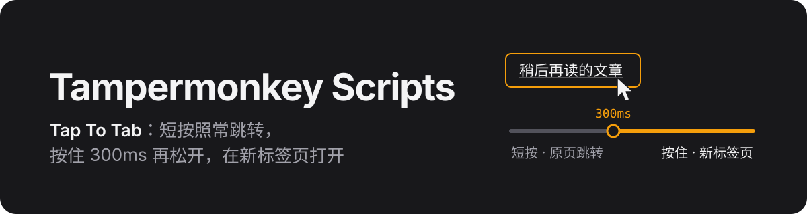

<p align="center">
  
</p>

## 脚本

| 脚本 | 作用 | 安装 |
| --- | --- | --- |
| [Tap To Tab](userscripts/tap-to-tab.user.js) `0.4.1` | 按住链接 300ms 后松开，在新标签页打开；短按照常跳转 | [安装](https://raw.githubusercontent.com/0xb3i/tampermonkey-scripts/main/userscripts/tap-to-tab.user.js) |

先在浏览器中装好 [Tampermonkey](https://www.tampermonkey.net/)，再点击表格中的「安装」，在弹出的 Tampermonkey 页面确认即可。

<details>
<summary><strong>Tap To Tab 细节</strong></summary>

- 普通短按不被拦截，保持网页原生跳转速度。
- 按住期间允许 `96px` 漂移，避免触控板轻微抖动打断计时；出现蓝框后移动超过 `32px` 即取消。
- 修饰键点击、下载链接、非 `_self` 链接、页内锚点与可编辑区域保持原生行为。

</details>

## 开发

脚本放在 `userscripts/`，每个脚本对应 `tests/` 下的纯 Node.js 单元测试，不依赖真实浏览器。需要 Node.js 20 或更高版本：

```bash
npm test
```

修改脚本时同步更新其 `@version`。更新到本机 Tampermonkey 或验证真实网页时，通过 **Chrome DevTools MCP** 操作当前 Chrome，并校验版本、启用状态与源码哈希：

```text
使用 Chrome DevTools MCP，将 userscripts/tap-to-tab.user.js 更新到当前 Chrome 的 Tampermonkey，并校验版本、启用状态和源码哈希。
```
