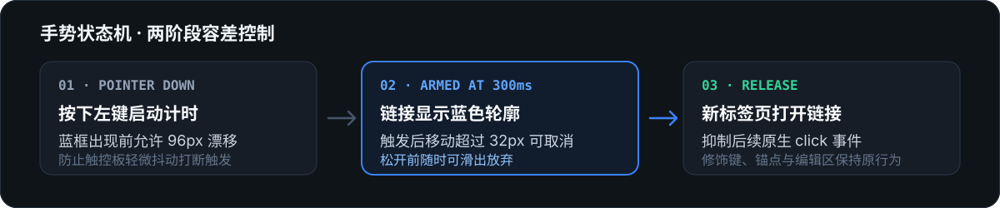

<p align="center">
  
</p>

<p align="center">
  <a href="userscripts/tap-to-tab.user.js">安装 Tap To Tab</a>&nbsp;&nbsp;·&nbsp;&nbsp;
  <a href="#手势机制">手势机制</a>&nbsp;&nbsp;·&nbsp;&nbsp;
  <a href="#开发与测试">开发与测试</a>&nbsp;&nbsp;·&nbsp;&nbsp;
  <a href="#同步到-tampermonkey">同步到 Tampermonkey</a>
</p>

## 脚本列表

| 脚本 | 版本 | 作用 |
| --- | --- | --- |
| [Tap To Tab](userscripts/tap-to-tab.user.js) | `0.4.1` | 短按链接正常跳转，按住链接 300ms 后松开在新标签页打开 |

## 手势机制

<p align="center">
  
</p>

- **短按零延迟**：普通短按不被拦截，保持网页原生跳转速度。
- **两阶段触控板防抖**：蓝框出现前允许 `96px` 漂移，避免触控板轻微抖动打断计时；蓝框出现后移动超过 `32px` 仍可取消。
- **边界保护**：修饰键点击、下载链接、非 `_self` 链接、页内锚点与可编辑区域保持原生行为。

## 安装

将 [userscripts/tap-to-tab.user.js](userscripts/tap-to-tab.user.js) 直接导入 Tampermonkey 即可使用。

## 开发与测试

要求 Node.js 20 或更高版本。仓库测试为不依赖浏览器的纯 Node.js 单元测试与仓库契约测试：

```bash
npm test
```

## 同步到 Tampermonkey

仓库不再提供浏览器控制、脚本同步 CLI 或 Node API。需要更新 Tampermonkey 或验证真实网页时，通过 **Chrome DevTools MCP** 操作当前 Chrome：

```text
使用 Chrome DevTools MCP，将 userscripts/tap-to-tab.user.js 更新到当前 Chrome 的 Tampermonkey，并校验版本、启用状态和源码哈希。
```

同步完成后应确认 Tampermonkey 中的脚本版本与本地 `@version` 一致、脚本处于启用状态、编辑器源码哈希与本地文件一致，并刷新需要加载新版本的现有网页。
